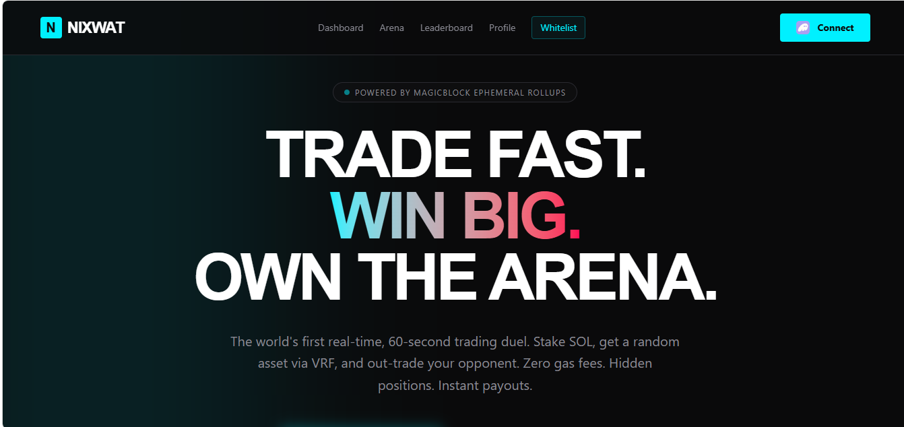
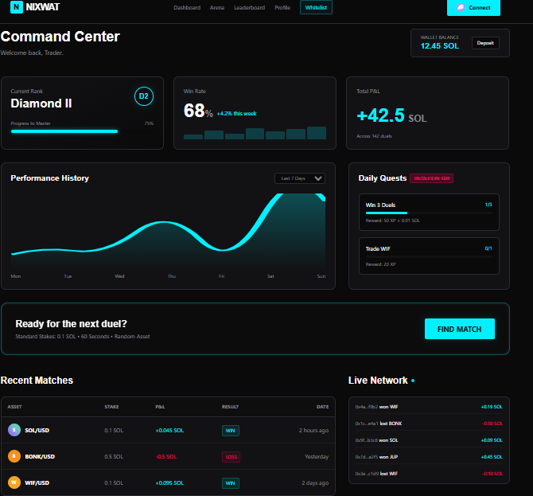
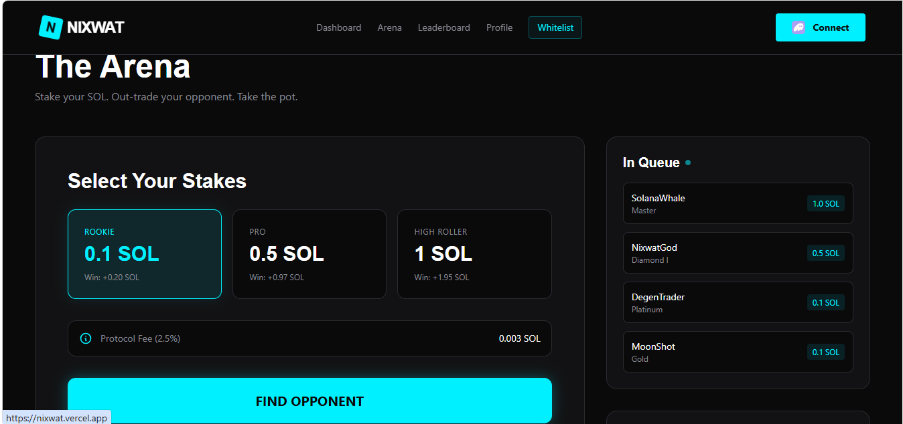
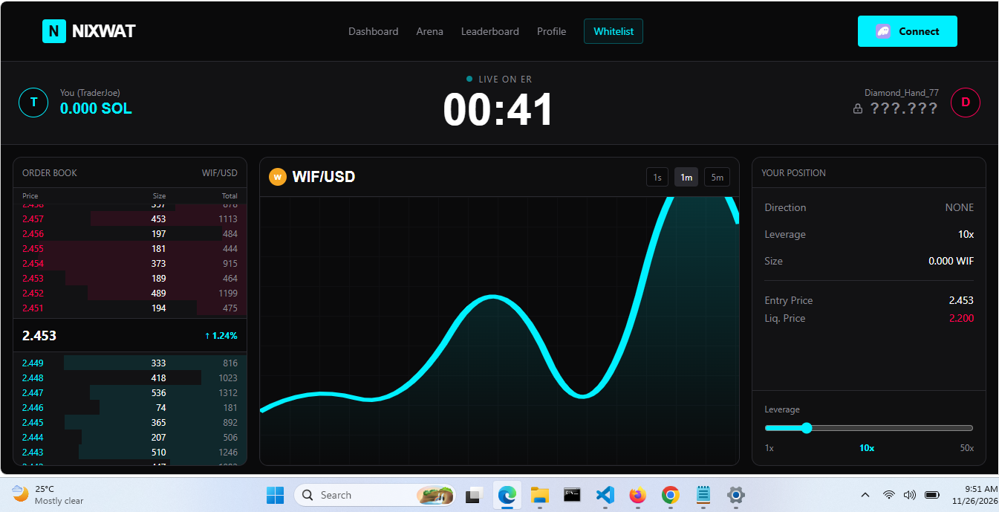
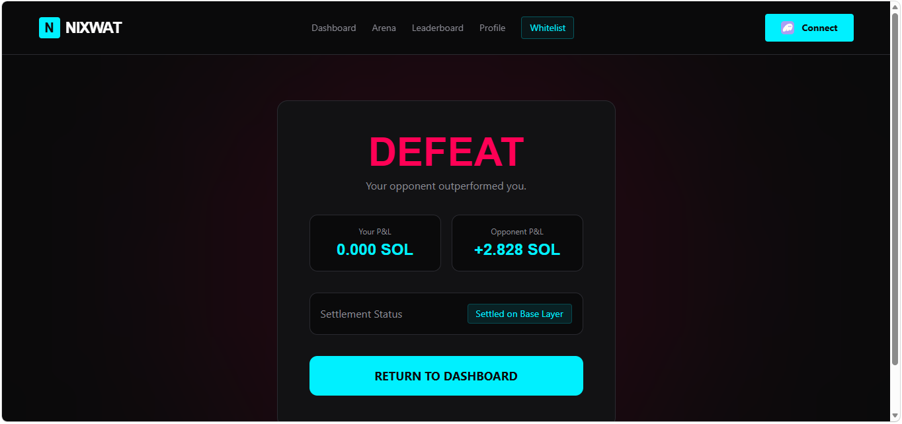
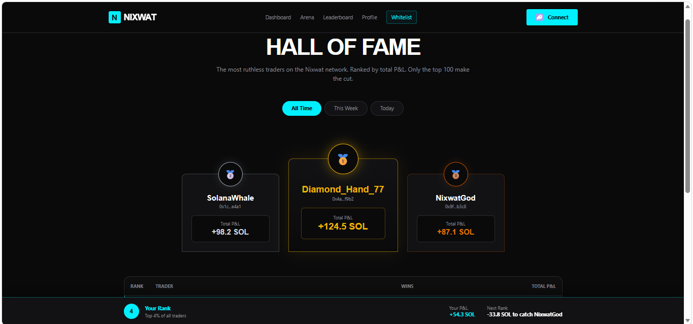
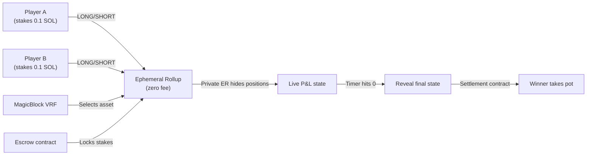
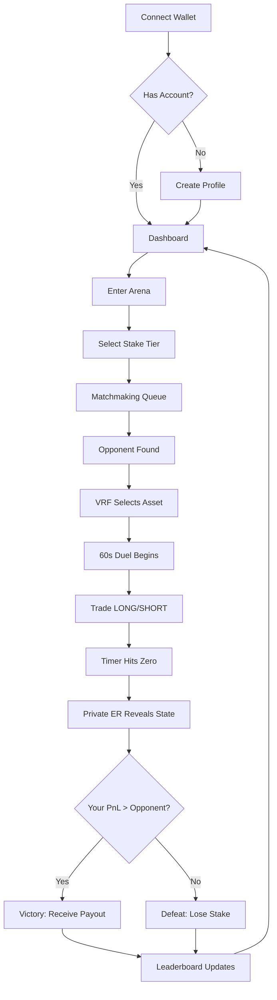

<div align="center">

# ⚔️ Nixwat

### Trade fast. Win big. Own the arena.

A real-time 1v1 trading duel on Solana. Stake SOL, get a VRF-selected asset, and out-trade your opponent over 60 seconds. Winner takes the pot.

[**🎮 Live Demo**](https://nixwat.vercel.app) · [**🎥 Demo Video**](https://youtube.com/placeholder) · [**📐 Architecture**](#architecture) · [**🗺 Roadmap**](#roadmap)


_Built for the MagicBlock Solana Blitz v10 Hackathon · Track: Entertainment Finance_

<!-- screenshot -->


</div>

---

## Table of contents

- [Why Nixwat](#why-nixwat)
- [Screenshots](#screenshots)
- [Quick demo (2 minutes)](#quick-demo-2-minutes)
- [How it works](#how-it-works)
- [MagicBlock integration](#magicblock-integration)
- [Architecture](#architecture)
- [User journey](#user-journey)
- [Tech stack](#tech-stack)
- [Prototype status](#prototype-status)
- [Run locally](#run-locally)
- [Project structure](#project-structure)
- [Roadmap](#roadmap)
- [Disclosures](#disclosures)
- [Troubleshooting](#troubleshooting)
- [License](#license)

---

## Why Nixwat

On-chain trading is slow, costly and boring to watch. A price can move 5% before a base-layer transaction confirms. Nixwat turns trading into a fast, fair, spectator-friendly **esport**.

| Approach             | Where rules live                         | Trade-offs                                                                  |
| -------------------- | ---------------------------------------- | --------------------------------------------------------------------------- |
| Base-layer DEX       | Solana L1                                | Slow (400ms+), gas fees, public positions (front-running)                   |
| Centralized exchange | Off-chain                                | Fast, but custodial, KYC, trust required                                    |
| **Nixwat**           | **Ephemeral Rollups + Private ER + VRF** | **Zero gas, instant execution, hidden positions, provably fair asset pick** |

---

## Screenshots

|                                  Landing                                  |                             Arena & matchmaking                              |
| :-----------------------------------------------------------------------: | :--------------------------------------------------------------------------: |
|  |  |

|                             VRF asset selection                              |                           Live duel terminal                            |
| :--------------------------------------------------------------------------: | :---------------------------------------------------------------------: |
|  |  |

|                           Victory / settlement                            |                                 Leaderboard                                  |
| :-----------------------------------------------------------------------: | :--------------------------------------------------------------------------: |
|  |  |

---

## Quick demo (2 minutes)

No keys or accounts needed. Just a Phantom wallet on Devnet.

1. Open **https://nixwat.vercel.app** and explore the landing page.
2. Click **Connect Wallet** and connect Phantom (Devnet).
3. Go to `/arena` and click **Find Opponent**. Watch matchmaking, then the **VRF animation** pick an asset (e.g. WIF/USD).
4. You land in `/duel/demo-match-123`: live chart, order book, position panel, leverage slider. Hit **LONG** or **SHORT**.
5. When the timer hits 0, the **Victory/Defeat** screen reveals both players' P&L.

---

## How it works

| Layer           | Mechanism                 | Effect                           |
| --------------- | ------------------------- | -------------------------------- |
| Matchmaking     | Next.js API + Supabase    | Pairs players of similar ELO     |
| Asset selection | MagicBlock VRF            | Provably fair random asset       |
| Trading         | Ephemeral Rollups         | Zero gas, near-instant execution |
| Privacy         | Private Ephemeral Rollups | Opponent P&L and size hidden     |
| Settlement      | Solana base layer         | Winner paid from escrow          |

**Settlement rules** (first failure decides the outcome):

| #   | Check                               | Result                               |
| --- | ----------------------------------- | ------------------------------------ |
| 1   | Player has enough balance for stake | else `insufficient balance`          |
| 2   | Match exists and isn't settled      | else `match already resolved`        |
| 3   | Timer has expired                   | else `match still active`            |
| 4   | Both final P&Ls recorded            | else `missing P&L data`              |
| 5   | Winner determined                   | `tie (refund)` or `winner takes pot` |

---

## MagicBlock integration

| Technology            | Role in Nixwat                                     | Why it matters                                                                    |
| --------------------- | -------------------------------------------------- | --------------------------------------------------------------------------------- |
| **Ephemeral Rollups** | All trades in the 60s duel run on the ER           | Zero gas and ultra-low latency; spam LONG/SHORT without waiting for confirmations |
| **Private ER**        | Hides opponent P&L, size and trades                | Stops copy-trading and front-running; pure skill                                  |
| **VRF**               | Picks the duel asset from a pool (SOL, BONK, WIF…) | Neither players nor devs can manipulate the pick                                  |

---

## Architecture



---

## User journey



---

## Tech stack

| Area      | Technology                                              |
| --------- | ------------------------------------------------------- |
| Framework | Next.js 14 (App Router), TypeScript                     |
| Styling   | Tailwind CSS, Framer Motion                             |
| Fonts     | Clash Display, JetBrains Mono                           |
| Wallet    | Solana Wallet Adapter (Phantom, Solflare)               |
| Data      | Supabase (profiles, leaderboard, match history)         |
| Prices    | Pyth Network (planned)                                  |
| Contracts | Anchor (Rust): Escrow, Matchmaker, Settlement (planned) |
| Hosting   | Vercel                                                  |

**Features:** real-time 1v1 duels · VRF asset selection · hidden positions · zero-gas trading · instant settlement · ELO leaderboard · profiles & achievements · daily quests.

---

## Prototype status

We're upfront about what's real today.

| Feature                                                                   | Status       |
| ------------------------------------------------------------------------- | ------------ |
| Full UI/UX (landing, arena, duel terminal, results, leaderboard, profile) | ✅ Built     |
| Wallet connect (Phantom / Solflare, Devnet)                               | ✅ Working   |
| Matchmaking and VRF animation                                             | 🟡 Simulated |
| Order book and price chart                                                | 🟡 Mocked    |
| MagicBlock ER / Private ER / VRF SDK                                      | 🔜 Next step |
| Anchor escrow and settlement contracts                                    | 🔜 Planned   |
| Real P2P matchmaking                                                      | 🔜 Planned   |

> ⚠️ Devnet only, not audited. Do not use real funds.

---

## Run locally

**Requirements:** Node.js 18+, npm, Phantom wallet (Devnet).

```bash
git clone https://github.com/yourusername/nixwat.git
cd nixwat
npm install
npm run dev
```

Open `http://localhost:3000` and connect Phantom or Solflare on **Devnet**.

---

## Project structure

| Path                | Contents                                                                |
| ------------------- | ----------------------------------------------------------------------- |
| `app/`              | Pages: Landing, Dashboard, Arena, Duel, Leaderboard, Profile, Whitelist |
| `app/globals.css`   | Design system (colors, fonts, Tailwind config)                          |
| `components/`       | Reusable UI (Navbar, WalletProvider)                                    |
| `docs/screenshots/` | README images                                                           |
| `public/`           | Static assets                                                           |

---

## Roadmap

- [ ] Real MagicBlock ER integration (on-chain duels)
- [ ] Real P2P matchmaking (Supabase Realtime / WebSockets)
- [ ] Pyth live price feeds
- [ ] Anchor escrow and settlement on Devnet
- [ ] Tournament mode with sponsored prize pools
- [ ] Spectator betting on live duels

---

## Disclosures

| Item             | Detail                                                                                             |
| ---------------- | -------------------------------------------------------------------------------------------------- |
| Hackathon window | All code written during MagicBlock Blitz v10 (Nov 20–27, 2026)                                     |
| AI assistance    | Built with Claude (Anthropic) as a coding assistant; the author ran and checked the code on Devnet |
| Libraries        | Next.js, Tailwind CSS, Solana Wallet Adapter, Framer Motion, MagicBlock SDK                        |
| Secrets          | No keys committed; wallet connection is client-side                                                |

---

## Troubleshooting

| Problem                              | Fix                                                  |
| ------------------------------------ | ---------------------------------------------------- |
| Wallet won't connect                 | Install Phantom and switch to **Devnet**             |
| Hydration error from `Math.random()` | Fixed by generating random values inside `useEffect` |
| Styles not loading                   | Run `npm install`, restart the dev server            |
| `Module not found`                   | Run `npm install`                                    |

---

## License

Released under the **MIT License**. See [`LICENSE`](LICENSE) for the full text.

Copyright (c) 2026 Changwrd

You are free to use, copy, modify, merge, publish, distribute, sublicense and sell copies of this software, as long as the copyright notice and license text are included in all copies.

The software is provided "as is", without warranty of any kind. Nixwat is a Devnet prototype and has not been audited, so do not use it with real funds.

**Third-party acknowledgements:** Next.js, Tailwind CSS, Framer Motion, Solana Wallet Adapter, Supabase, and MagicBlock are the property of their respective owners and are used under their own licenses.
